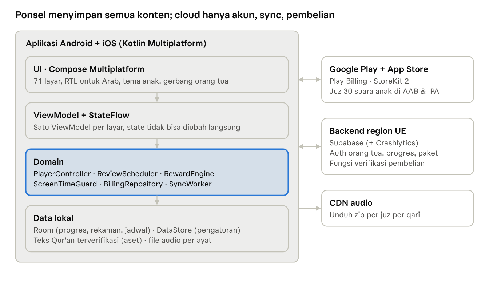

# PRD Bustan Qur'an (بستان القرآن) — Aplikasi Android & iOS (A–Z) + Prompt Develop

Nov 24, 2026 · @arob

## 1. Ringkasan produk

Bustan Qur'an (بستان القرآن, "Kebun Al-Qur'an") adalah aplikasi Android dan iOS offline-first, dibangun dari satu kode Kotlin Multiplatform, untuk anak 3–10 tahun di Timur Tengah dan Eropa. Anak belajar hijaiyah, menghafal Juz 'Amma, dan memahami makna ayat lewat 24 mini game, pemutar qari dengan loop per ayat atau per surat, serta sistem bintang dan kartu. Orang tua memantau lewat dashboard yang dikunci gerbang orang tua.

**Tujuan bisnis MVP (6 bulan setelah rilis)**

- 100.000 unduhan, retensi D7 ≥ 30%, konversi berbayar 3–5%.
- Nol kesalahan teks Al-Qur'an yang terkonfirmasi.
- Rating Play Store dan App Store ≥ 4,6.

**Prinsip produk**

1. Bacaan akurat di atas segalanya: semua teks dan audio diverifikasi hafiz.
2. Aman untuk anak: tanpa iklan, tanpa chat, data minimal, semua izin lewat orang tua.
3. Offline-first: semua yang sudah diunduh jalan tanpa internet.
4. Sesi pendek 3–7 menit, tanpa "kalah", hadiah tanpa unsur kecanduan.
5. Membantu, bukan menggantikan guru ngaji atau orang tua.

**Dokumen terkait**

- [Spesifikasi produk (fitur, pasar, harga)](https://claude.ai/artifact/GQtUvAtApU3i2NSayDW6S2)
- [Desain UI di canvas: 71 layar, bisa diklik](https://claude.ai/artifact/3Go3zN69CsHLcX8fqBoSXd)
- Referensi awal: [Alquran Play](https://haimasday.web.id/aqplay)

**Konvensi dokumen ini:** ID kebutuhan berbentuk `MOD-NN` (misalnya `AUD-03`). Prompt AI coding di bagian 18 ditulis dalam bahasa Inggris agar hasilnya lebih konsisten di Claude Code, Cursor, atau Android Studio Gemini.

## 2. Lingkup rilis

MVP fokus pada Juz 'Amma, 4 bahasa, dan rilis bersamaan di Android dan iOS (ponsel) dari satu kode Kotlin Multiplatform + Compose Multiplatform. Semua layar di canvas dikerjakan bertahap dalam 3 rilis. Mode guru lengkap **tidak** dikerjakan; hanya layar mode guru dasar (lihat & dengar setoran) di v2.

| Rilis | Target | Isi |
| --- | --- | --- |
| MVP 1.0 | Bulan 5 | Onboarding, gerbang orang tua, akun, privasi, profil anak, peta petualangan, hijaiyah, mushaf Juz 'Amma, pemutar qari + loop per ayat/surat, hafalan 3 langkah, peta hafalan + murojaah, 18 game, hadiah & koleksi, dashboard + laporan + rekaman, pengaturan, paket & pembelian, unduhan, keadaan offline/kosong/memuat. Bahasa EN, AR, FR, DE. Platform Android + iOS. |
| v1.1 | Bulan 7 | 6 game sisa, tajwid 8 hukum, doa harian, kisah nabi, layar istirahat, sertifikat, tata letak tablet Android & iPad. |
| v2.0 | Bulan 9–12 | 30 juz penuh, cek bacaan dengan suara (on-device), Asmaul Husna, wudhu, salat, rukun Islam/iman, mode Ramadan, mode guru dasar, bahasa TR, NL, UR, ID, MS, riwayat Warsh. |

**Tidak dikerjakan (out of scope)**

- Mode guru lengkap: buat tugas, kuis kelas langsung, manajemen kelas, ekspor laporan kelas.
- Chat, forum, papan peringkat publik, atau fitur sosial apa pun.
- Iklan dalam bentuk apa pun.
- Terjemahan Al-Qur'an otomatis (mesin).
- Versi web.

## 3. Persona & user stories

Ada dua pengguna: anak (pemakai) dan orang tua (pembeli & pengawas). Anak tidak pernah punya akun sendiri.

| Persona | Tahap | Kebutuhan utama |
| --- | --- | --- |
| Maryam, 4 th | Little Stars (3–4) | Belum bisa membaca; navigasi gambar + suara; game ketuk dan dengar |
| Adam, 5 th | Explorers (5–6) | Hijaiyah lengkap, harakat, hafalan surah pendek pertama |
| Yusuf, 7 th | Young Hafiz (7–10) | Hafalan Juz 'Amma, loop per ayat, tajwid dasar, makna |
| Umm Khalid, Riyadh | Orang tua (AR) | Bacaan Hafs akurat, tanpa musik, laporan progres |
| Amina, Lyon | Orang tua (FR) | Instruksi bahasa Prancis, transliterasi, privasi GDPR |

**User stories prioritas MVP**

1. Sebagai anak 4 tahun, saya bisa membuka game huruf dari peta dalam ≤ 2 ketukan tanpa membaca.
2. Sebagai anak 7 tahun, saya bisa memilih Surah Quraisy, memutar qari, dan mengulang satu ayat 3x sebelum lanjut ke ayat berikutnya.
3. Sebagai anak, saya bisa mengulang satu surat penuh berkali-kali (1x, 3x, 5x, 10x, ∞).
4. Sebagai anak, saya merekam bacaan saya dan mendengarnya kembali di samping suara qari.
5. Sebagai anak, saya mendapat bintang dan kartu setelah menyelesaikan sesi, tanpa pernah "kalah".
6. Sebagai orang tua, saya melihat menit belajar, ayat baru, dan ayat yang perlu diulang per anak setiap minggu.
7. Sebagai orang tua, saya mengatur batas waktu layar, bahasa arti, qari, dan musik.
8. Sebagai orang tua, saya membeli paket sekali bayar lewat Google Play dan memulihkannya di ponsel lain.
9. Sebagai orang tua, saya bisa mengekspor atau menghapus semua data keluarga.
10. Sebagai keluarga tanpa internet stabil, saya tetap bisa memakai semua konten yang sudah diunduh.

## 4. Peta layar

Ada 71 layar desain. Nama file sama dengan artboard di [canvas desain](https://claude.ai/artifact/3Go3zN69CsHLcX8fqBoSXd); developer memakai nama ini sebagai nama route/screen di kode (misalnya `MurottalQuraisy` → `SurahPlayerScreen`).

| No | Layar | File desain | Modul | Rilis |
| --- | --- | --- | --- | --- |
| 1 | Pilih profil anak | Main | PRF | MVP |
| 2 | Peta Petualangan | Home | NAV | MVP |
| 3 | Game Balon Huruf | BalonHuruf | GAM | MVP |
| 4 | Game Susun Ayat | SusunAyat | GAM | MVP |
| 5 | Hafalan 3 langkah | Hafalan | HFZ | MVP |
| 6 | Layar hadiah | Reward | RWD | MVP |
| 7 | Dashboard orang tua | ParentDashboard | PAR | MVP |
| 8 | Beranda (Arab) | HomeArabic | L10 | MVP |
| 9 | Pemutar surat + loop | MurottalQuraisy | AUD | MVP |
| 10 | Sambutan & bahasa | Onboarding | ONB | MVP |
| 11 | Gerbang orang tua | ParentGate | ONB | MVP |
| 12 | Tambah profil anak | AddChild | PRF | MVP |
| 13 | Paket & harga | Paywall | PAY | MVP |
| 14 | Pengaturan | Settings | SET | MVP |
| 15 | Daftar surat | QuranLibrary | QRN | MVP |
| 16 | Peta hafalan & murojaah | HafalanMap | HFZ | MVP |
| 17 | Pelajaran hijaiyah | HijaiyahLesson | HIJ | MVP |
| 18 | Pelajaran tajwid | TajwidLesson | TJW | v1.1 |
| 19 | Daftar game | GameList | GAM | MVP |
| 20 | Game Ikan Harakat | IkanHarakat | GAM | MVP |
| 21 | Game Memori Kata | MemoriKata | GAM | MVP |
| 22 | Game Sambung Ayat | SambungAyat | GAM | MVP |
| 23 | Doa harian | DoaHarian | ISL | v1.1 |
| 24 | Kisah nabi | KisahNabi | ISL | v1.1 |
| 25 | Koleksi kartu & lencana | KoleksiKartu | RWD | MVP |
| 26 | Waktunya istirahat | Istirahat | SET | v1.1 |
| 27 | Mode guru dasar | ModeGuru | TCH | v2 |
| 28 | Masuk / daftar | SignIn | ACC | MVP |
| 29 | Lupa kata sandi | ForgotPassword | ACC | MVP |
| 30 | Persetujuan privasi | PrivacyConsent | ACC | MVP |
| 31 | Pembelian berhasil | PurchaseSuccess | PAY | MVP |
| 32 | Pulihkan pembelian | RestorePurchase | PAY | MVP |
| 33 | Laporan mingguan | WeeklyReport | PAR | MVP |
| 34 | Rekaman suara anak | ChildRecordings | PAR | MVP |
| 35 | Sertifikat khatam | Certificate | RWD | v1.1 |
| 36 | Halaman mushaf | MushafPage | QRN | MVP |
| 37 | Detail kata | WordDetail | QRN | MVP |
| 38 | Pengaturan mushaf | MushafSettings | QRN | MVP |
| 39 | Pilih qari | ReciterPicker | AUD | MVP |
| 40 | Unduhan audio | DownloadManager | DLD | MVP |
| 41 | Offline | OfflineState | SYS | MVP |
| 42 | Audio belum diunduh | AudioMissing | DLD | MVP |
| 43 | Belum ada progres | EmptyProgress | SYS | MVP |
| 44 | Memuat | Loading | SYS | MVP |
| 45–57 | 13 game tambahan | GKebunHuruf … GKeluarga | GAM | MVP / v1.1 (lihat bagian 6) |
| 58 | Asmaul Husna | AsmaulHusna | ISL | v2 |
| 59 | Panduan wudhu | WudhuGuide | ISL | v2 |
| 60 | Panduan salat | SalatGuide | ISL | v2 |
| 61 | Rukun Islam & iman | RukunIslam | ISL | v2 |
| 62 | Mode Ramadan | RamadanMode | ISL | v2 |
| 63 | Hasil cek bacaan | VoiceCheck | HFZ | v2 |
| 64–67 | Profil, pemutar, Susun Ayat, dashboard (Arab) | MainArabic, MurottalArabic, SusunAyatArabic, ParentDashboardArabic | L10 | MVP |
| 68–69 | Peta petualangan (FR, DE) | HomeFrench, HomeGerman | L10 | MVP |
| 70–71 | Peta & pemutar (tablet) | HomeTablet, MurottalTablet | TAB | v1.1 |

**Alur utama:** Memuat → Sambutan & bahasa → Gerbang orang tua → Masuk/daftar → Persetujuan privasi → Tambah anak → Pilih profil → Peta Petualangan → (Pulau Huruf → Daftar game → Game → Hadiah) atau (Qur'an → Daftar surat → Pemutar/Hafalan → Hadiah). Orang tua: Pilih profil → Gerbang → Dashboard → Laporan / Pengaturan / Paket.

## 5. Kebutuhan fungsional per modul

Setiap kebutuhan punya ID dan kriteria terima yang bisa diuji. Prioritas: **P0** wajib di MVP, **P1** MVP bila waktu cukup, **P2** rilis berikutnya.

### ONB — Onboarding & gerbang orang tua

| ID | Kebutuhan | Kriteria terima | P |
| --- | --- | --- | --- |
| ONB-01 | Layar memuat + sambutan dengan pilihan bahasa EN/AR/FR/DE | Bahasa terpilih langsung mengubah seluruh UI; AR membalik tata letak ke RTL | P0 |
| ONB-02 | Gerbang orang tua: soal hitungan tertulis dalam kata, 3 pilihan jawaban, soal acak tiap kali | Jawaban salah tidak membuka apa pun; soal berganti setelah 1 salah | P0 |
| ONB-03 | Gerbang dipasang sebelum: dashboard, pengaturan, pembelian, tautan keluar, tambah anak | Tidak ada jalur ke layar tersebut tanpa lolos gerbang (uji navigasi) | P0 |

### ACC — Akun orang tua & privasi

| ID | Kebutuhan | Kriteria terima | P |
| --- | --- | --- | --- |
| ACC-01 | Masuk/daftar dengan Google, Apple (wajib tersedia di iOS), atau email + kata sandi | Akun dibuat di backend; token disimpan aman (EncryptedSharedPreferences di Android, Keychain di iOS) | P0 |
| ACC-02 | Lupa kata sandi lewat email | Link reset terkirim; progres lokal tetap utuh | P0 |
| ACC-03 | Mode tanpa akun (lokal saja) | Semua fitur jalan; sinkronisasi dan pemulihan lintas perangkat dinonaktifkan dengan penjelasan | P1 |
| ACC-04 | Persetujuan privasi: progres (wajib), backup rekaman (opsional, default mati), statistik anonim (opsional, default mati), centang wali | Tombol lanjut nonaktif sampai centang wali; pilihan disimpan dengan timestamp | P0 |
| ACC-05 | Ekspor & hapus semua data dari Pengaturan | Ekspor JSON lengkap; hapus menghapus server + lokal dalam ≤ 30 hari, dengan konfirmasi | P0 |

### PRF — Profil anak

| ID | Kebutuhan | Kriteria terima | P |
| --- | --- | --- | --- |
| PRF-01 | Hingga 6 profil per keluarga (3 di paket Juz 'Amma, 1 di gratis) | Batas sesuai paket; ajakan upgrade saat penuh | P0 |
| PRF-02 | Data profil: nama panggilan, tahap usia (3–4 / 5–6 / 7–10), avatar hewan | Tidak meminta nama lengkap atau tanggal lahir | P0 |
| PRF-03 | Pilih profil dengan 1 ketukan di layar awal | Konten dan progres berganti sesuai profil | P0 |

### NAV — Peta petualangan & navigasi

| ID | Kebutuhan | Kriteria terima | P |
| --- | --- | --- | --- |
| NAV-01 | Peta berisi 4 pulau: Huruf, Surat, Doa, Kisah | Setiap pulau terbuka dalam ≤ 2 ketukan dari peta | P0 |
| NAV-02 | Kartu target harian di atas peta | Progres menit/ayat diperbarui langsung setelah sesi | P0 |
| NAV-03 | Navigasi bawah: Peta, Qur'an, Kartu Saya | Ikon + label + suara saat diketuk (mode Little Stars) | P0 |
| NAV-04 | Pulau terkunci bila prasyarat belum selesai (dari tahap usia) | Ikon gembok + suara penjelasan | P1 |

### QRN — Al-Qur'an & mushaf

| ID | Kebutuhan | Kriteria terima | P |
| --- | --- | --- | --- |
| QRN-01 | Daftar surat Juz 'Amma (114 → 78) dengan status hafalan dan pencarian | Status: hafal / belajar / belum / perlu diulang | P0 |
| QRN-02 | Halaman mushaf rasm Utsmani, riwayat Hafs, per halaman Madinah | Teks identik dengan sumber terverifikasi (cek checksum) | P0 |
| QRN-03 | Ketuk kata → audio kata, arti, transliterasi | Waktu respon ≤ 200 ms dari data lokal | P0 |
| QRN-04 | Pengaturan: ukuran teks 3 level, tajwid berwarna on/off, transliterasi, bahasa arti, mode malam | Pengaturan tersimpan per profil | P0 |
| QRN-05 | 30 juz penuh | Semua 604 halaman tersedia | P2 |

### AUD — Pemutar qari & loop (detail di bagian 7)

| ID | Kebutuhan | Kriteria terima | P |
| --- | --- | --- | --- |
| AUD-01 | Putar per ayat dengan sorotan ayat aktif | Sorotan berpindah ≤ 100 ms setelah audio ayat dimulai | P0 |
| AUD-02 | Mode loop per ayat: ulang N kali (1, 3, 5, 10, ∞), lalu otomatis ke ayat berikutnya | Hitungan ulangan tampil "Ulang 2 dari 3"; ∞ tidak pernah pindah ayat | P0 |
| AUD-03 | Mode loop per surat: putar ayat 1 → akhir, ulang surat N kali | Setelah N putaran berhenti dan kembali ke ayat 1 | P0 |
| AUD-04 | Ketuk ayat mana pun untuk mulai dari ayat itu | Hitungan ulangan direset | P0 |
| AUD-05 | Kecepatan 0,5x / 0,75x / 1x / 1,25x tanpa mengubah nada | Android: PlaybackParameters ExoPlayer; iOS: AVPlayer rate dengan algoritma pitch time-domain | P0 |
| AUD-06 | Jeda otomatis setelah tiap ayat untuk anak menirukan (0 / 2 / 4 detik) | Jeda diterapkan di antara ulangan | P1 |
| AUD-07 | Putar di latar dan dari layar kunci dengan notifikasi media | Kontrol play/pause/next di notifikasi | P1 |
| AUD-08 | Pilih qari: suara anak laki-laki, anak perempuan, 2 qari dewasa | Pilihan tersimpan per profil | P0 |

### HFZ — Hafalan & murojaah

| ID | Kebutuhan | Kriteria terima | P |
| --- | --- | --- | --- |
| HFZ-01 | Metode 3 langkah: Dengar 3x → Tiru 3x (rekam) → Baca sendiri | Langkah 3 terbuka setelah langkah 1–2 selesai | P0 |
| HFZ-02 | Teks memudar bertahap: utuh → sebagian hilang → huruf awal → kosong | 4 level, dipilih otomatis dari jumlah percobaan berhasil | P0 |
| HFZ-03 | Rekam suara anak, simpan lokal (format AAC/m4a), putar banding dengan qari | Rekaman terhapus otomatis setelah 90 hari kecuali disimpan | P0 |
| HFZ-04 | Jadwal murojaah berjarak (spaced repetition, SM-2 sederhana) | Kotak murojaah harian 3–5 tugas dari surat yang sudah dihafal | P0 |
| HFZ-05 | Peta hafalan 37 surat Juz 'Amma dengan 4 status warna | Ketuk sel membuka surat | P0 |
| HFZ-06 | Cek bacaan dengan pengenalan suara on-device, hasil per kata | Selalu disertai catatan "bantuan, bukan nilai guru" | P2 |

### HIJ & TJW — Hijaiyah dan tajwid

| ID | Kebutuhan | Kriteria terima | P |
| --- | --- | --- | --- |
| HIJ-01 | 28 huruf: bunyi, 4 bentuk (sendiri/awal/tengah/akhir), contoh kata, makhraj | Semua 28 huruf punya audio terverifikasi | P0 |
| HIJ-02 | Latihan menulis dengan jari (tracing) dengan titik awal dan arah | Garis dinilai benar bila ≥ 70% jalur tertutup | P0 |
| HIJ-03 | Kurikulum Qaida/Iqra jilid 1–6 dengan label per pasar | Label berganti sesuai bahasa | P1 |
| TJW-01 | 8 hukum tajwid dasar, masing-masing animasi + contoh audio + kuis 3 soal | Kuis memberi umpan balik benar/salah langsung | P1 |

### RWD — Hadiah & koleksi

| ID | Kebutuhan | Kriteria terima | P |
| --- | --- | --- | --- |
| RWD-01 | 1–3 bintang per sesi | Bintang = akurasi (≥ 90% = 3, ≥ 60% = 2, selesai = 1) | P0 |
| RWD-02 | 12 kartu hewan dalam Al-Qur'an, dibuka tiap 5 sesi selesai | Kartu baru tampil di layar hadiah | P0 |
| RWD-03 | 8 lencana (surat pertama, 7 hari beruntun, dst.) | Kriteria lencana tertulis di kartunya | P0 |
| RWD-04 | Sertifikat PDF khatam Juz 'Amma | Bisa dicetak dan dibagikan via share sheet | P1 |
| RWD-05 | Tanpa mata uang yang bisa dibeli, tanpa loot box, tanpa streak yang menghukum | Streak putus tidak menghapus apa pun | P0 |

### PAR — Dashboard orang tua

| ID | Kebutuhan | Kriteria terima | P |
| --- | --- | --- | --- |
| PAR-01 | Ringkasan minggu per anak: menit, ayat baru, perlu diulang | Data dari database lokal, tidak perlu internet | P0 |
| PAR-02 | Laporan mingguan: menit per hari (grafik batang), sorotan, tips | Laporan dibuat otomatis tiap Senin 06.00 waktu lokal | P0 |
| PAR-03 | Daftar rekaman anak: putar, banding qari, hapus | Hapus meminta konfirmasi | P0 |
| PAR-04 | Notifikasi pengingat harian untuk orang tua (opsional) | Default mati; jam diatur orang tua | P1 |

### SET — Pengaturan & waktu layar

| ID | Kebutuhan | Kriteria terima | P |
| --- | --- | --- | --- |
| SET-01 | Bahasa app, bahasa arti, qari, riwayat, transliterasi, tajwid berwarna, suara latar, backup rekaman | Semua tersimpan per profil atau per keluarga sesuai jenisnya | P0 |
| SET-02 | Batas waktu harian (10–60 menit) | Saat habis tampil layar Istirahat; tambah 10 menit hanya lewat gerbang orang tua | P0 |
| SET-03 | Musik: tanpa musik (default di Teluk) / rebana / suara alam | Default berdasarkan negara Play Store | P0 |

### PAY — Paket & pembelian

| ID | Kebutuhan | Kriteria terima | P |
| --- | --- | --- | --- |
| PAY-01 | Produk: Juz 'Amma (sekali bayar), 30 Juz Lifetime (sekali bayar), Keluarga (langganan bulanan/tahunan) | Play Billing Library v7+ (Android) dan StoreKit 2 (iOS) dengan product ID yang sama | P0 |
| PAY-02 | Harga lokal per negara (SAR, AED, EUR, GBP) | Diatur di Play Console dan App Store Connect, ditampilkan dari data harga toko masing-masing | P0 |
| PAY-03 | Verifikasi pembelian di server sebelum membuka konten | Diverifikasi lewat Google Play Developer API (Android) atau App Store Server API (iOS) | P0 |
| PAY-04 | Pulihkan pembelian | Mendeteksi pembelian aktif di akun Google atau Apple ID yang sama | P0 |
| PAY-05 | Layar berhasil + ajakan unduh audio | Tampil setelah pembelian terverifikasi | P0 |

### DLD & SYS — Unduhan dan keadaan sistem

| ID | Kebutuhan | Kriteria terima | P |
| --- | --- | --- | --- |
| DLD-01 | Juz 'Amma suara anak dibundel di AAB (Android) dan IPA (iOS) | Bisa diputar tanpa internet setelah instal | P0 |
| DLD-02 | Unduh audio per juz per qari, jeda/lanjut, Wi-Fi saja (default) | WorkManager (Android) / URLSession background + BGTaskScheduler (iOS); tahan restart | P0 |
| DLD-03 | Info ruang penyimpanan dan hapus unduhan | Ukuran per juz ditampilkan | P0 |
| DLD-04 | Lembar "audio belum diunduh" saat memutar juz yang belum ada | Pilihan unduh sekarang / baca tanpa audio | P0 |
| SYS-01 | Keadaan offline, kosong, memuat, dan error dengan bahasa ramah anak | Tidak ada pesan teknis yang tampil ke anak | P0 |

### ISL — Konten Islami

| ID | Kebutuhan | Kriteria terima | P |
| --- | --- | --- | --- |
| ISL-01 | 6+ doa harian dengan audio dan mode "ucapkan bersama" | Status "sudah hafal" per doa | P1 |
| ISL-02 | Kisah 25 nabi sebagai audio-book per bab + kuis | Tanpa gambar wajah nabi, sahabat, atau malaikat | P1 |
| ISL-03 | Asmaul Husna 99 nama dengan nasyid vokal | Progres x/99 | P2 |
| ISL-04 | Panduan wudhu 8 langkah dan salat 9 langkah | Catatan: ikuti madzhab keluarga | P2 |
| ISL-05 | Rukun Islam & iman | Dua tab, tautan ke wudhu & salat | P2 |
| ISL-06 | Mode Ramadan: kalender 30 hari, target khatam Juz 'Amma, doa berbuka | Aktif otomatis selama Ramadan sesuai kalender Hijriah lokal | P2 |

### TCH — Mode guru dasar (v2)

| ID | Kebutuhan | Kriteria terima | P |
| --- | --- | --- | --- |
| TCH-01 | Guru melihat daftar murid dan mendengar rekaman setoran yang dikirim orang tua | Anak bergabung hanya dengan persetujuan orang tua; tanpa membuat tugas atau kuis | P2 |

## 6. Spesifikasi 24 game

Ada 18 game di MVP dan 6 game di v1.1. Game 24 "Lomba Kelas" diganti "Kuis Kilat Murojaah" (main sendiri) karena mode guru lengkap tidak dikerjakan; kartu di layar Daftar game perlu disesuaikan.

**Aturan untuk semua game**

- Satu sesi 1–3 menit, 5 ronde. Level 1 dengan petunjuk, Level 2 tanpa petunjuk; naik level setelah 2 sesi dengan 3 bintang.
- Jawaban salah memberi petunjuk suara, tidak pernah "game over".
- Teks ayat tidak pernah menjadi objek yang ditembak, diinjak, dilempar, atau jatuh ke tanah. Objek yang "diletuskan" hanya membawa huruf satuan.
- Semua instruksi diputar sebagai suara di bahasa antarmuka; tombol "dengar lagi" selalu ada.
- Konten game diambil dari tabel `game_content` (bagian 9), bukan ditulis di kode.
- Hasil sesi dikirim ke modul hadiah: `GameResult(gameId, profileId, correct, total, durationSec)`.

| No | Game | Tahap | Mekanik | Konten | Rilis | File desain |
| --- | --- | --- | --- | --- | --- | --- |
| 1 | Balon Huruf | 3–4 | Huruf disebut, ketuk balon yang membawanya; 5 balon melayang | 28 huruf | MVP | BalonHuruf |
| 2 | Kebun Huruf | 3–4 | Siram kuncup, bunga mekar dan menyebut huruf; anak mengulang | 28 huruf | MVP | GKebunHuruf |
| 3 | Jejak Jari | 3–4 | Menebalkan huruf dari titik awal | 28 huruf | MVP | HijaiyahLesson |
| 4 | Pasangkan Bayangan | 3–4 | Ketuk huruf lalu bayangannya; huruf mirip (ب ت ث) | Grup huruf mirip | MVP | GBayangan |
| 5 | Kereta Surat | 3–4 | Tiap gerbong memutar satu ayat; urut dari depan | Surat pendek | MVP | GKeretaSurah |
| 6 | Doa Si Kecil | 3–4 | Pilih gambar situasi, dengar doanya | 6 doa | MVP | DoaHarian |
| 7 | Ikan Harakat | 3–4 | Pancing ikan dengan bunyi yang disebut (ba/bi/bu) | Huruf × 3 harakat | MVP | IkanHarakat |
| 8 | Bintang Malam | 3–4 | Ketuk bintang sebanyak angka Arab yang tampil | Angka ١–١٠ | MVP | GBintang |
| 9 | Sambung Huruf | 5–6 | Ketuk huruf berurutan menjadi kata bersambung | 40 kata pendek | MVP | GSambungHuruf |
| 10 | Lari Hijaiyah | 5–6 | Pelari otomatis; tekan lompat hanya pada huruf target | Grup huruf mirip | v1.1 | GLariHijaiyah |
| 11 | Ayat Hilang | 5–6 | Dengar ayat, pilih kata yang hilang dari 3 pilihan | Juz 'Amma | MVP | GAyatHilang |
| 12 | Urutkan Ayat | 5–6 | Ketuk kartu ayat dari pertama sampai terakhir | Surat ≤ 8 ayat | MVP | GUrutkanAyat |
| 13 | Memori Kata | 5–6 | Kartu memori: kata Arab ↔ gambar | 60 kosakata Qur'an | MVP | MemoriKata |
| 14 | Tiru Qari | 5–6 | Dengar, rekam, banding | Juz 'Amma | MVP | Hafalan |
| 15 | Pasar Huruf | 5–6 | Beli huruf berurutan untuk mengeja nama surat | 37 nama surat | v1.1 | GPasarHuruf |
| 16 | Tebak Surat | 5–6 | Dengar 3 detik awal, pilih surat dari 3 | Juz 'Amma | MVP | GTebakSurah |
| 17 | Susun Ayat | 7–10 | Susun kata Arab di halaman mushaf kosong | Juz 'Amma per ayat | MVP | SusunAyat |
| 18 | Susun Arti | 7–10 | Susun potongan arti dalam bahasa anak | Arti berlisensi | MVP | GSusunArti |
| 19 | Detektif Tajwid | 7–10 | Temukan hukum tajwid di ayat | 8 hukum | v1.1 | TajwidLesson |
| 20 | Sambung Ayat | 7–10 | Dengar ayat, pilih ayat berikutnya | Juz 'Amma | MVP | SambungAyat |
| 21 | Kuis Kisah | 7–10 | 4 soal pilihan ganda per kisah | 25 kisah | v1.1 | GKuisKisah |
| 22 | Petualangan Peta Hafalan | 7–10 | Buka pulau baru tiap surat dikuasai | Peta hafalan | MVP | HafalanMap |
| 23 | Tantangan Keluarga | 7–10 | 2 pemain bergantian di 1 ponsel menyambung ayat; pemain lain menilai | Juz 'Amma | v1.1 | GKeluarga |
| 24 | Kuis Kilat Murojaah | 7–10 | 10 soal campuran dari surat yang sudah dihafal, 60 detik, tanpa hukuman waktu habis | Jadwal murojaah | v1.1 | (baru) |

## 7. Mesin audio & logika loop

Audio disimpan satu file per ayat. Dengan begitu loop per ayat dan per surat cukup mengatur antrean dan hitungan, tanpa memotong file panjang.

**Format & penamaan file**

- Nama file `SSSAAA.mp3`: 3 digit nomor surat + 3 digit nomor ayat. Contoh Quraisy: `106001.mp3` … `106004.mp3`.
- MP3 64 kbps mono untuk suara anak (cukup jelas, hemat ruang), 128 kbps untuk qari dewasa.
- Basmalah sebagai file terpisah `001001.mp3` (dipakai di awal tiap surat kecuali At-Taubah) atau `SSS000.mp3`.
- Folder: `audio/{reciterId}/{SSSAAA}.mp3`, dibundel (Juz 30 suara anak) atau diunduh per juz sebagai zip lalu diekstrak.
- File timing per kata `timing/{reciterId}/{SSS}.json` berisi `[{ayah, word, startMs, endMs}]` untuk sorotan kata (P1).

**State pemutar**

```kotlin
data class PlayerState(
    val surah: Int,
    val ayahCount: Int,
    val currentAyah: Int = 1,
    val mode: LoopMode = LoopMode.PER_AYAH,   // PER_AYAH | PER_SURAH
    val target: Int = 3,                      // 0 = infinite
    val count: Int = 0,                       // repetitions completed for current unit
    val isPlaying: Boolean = false,
    val speed: Float = 1.0f,                  // 0.5, 0.75, 1.0, 1.25
    val pauseAfterAyahMs: Long = 0,           // 0, 2000, 4000
    val reciterId: String = "child_boy"
)
```

**Aturan saat satu file ayat selesai diputar (`onAyahCompleted`)**

```kotlin
fun onAyahCompleted(s: PlayerState): PlayerState {
    val max = if (s.target == 0) Int.MAX_VALUE else s.target
    return when (s.mode) {
        LoopMode.PER_AYAH -> {
            val next = s.count + 1
            when {
                next < max -> s.copy(count = next)                        // repeat same ayah
                s.currentAyah < s.ayahCount -> s.copy(currentAyah = s.currentAyah + 1, count = 0)
                else -> s.copy(isPlaying = false, count = 0)              // surah finished
            }
        }
        LoopMode.PER_SURAH -> when {
            s.currentAyah < s.ayahCount -> s.copy(currentAyah = s.currentAyah + 1)
            s.count + 1 < max -> s.copy(currentAyah = 1, count = s.count + 1)  // loop surah
            else -> s.copy(isPlaying = false, currentAyah = 1, count = 0)
        }
    }
}
```

**Aturan interaksi**

1. Ganti mode → `count = 0`; ke mode per surat juga `currentAyah = 1`.
2. Ketuk ayat atau tombol sebelumnya/berikutnya → `currentAyah` diganti, `count = 0`, pemutaran lanjut bila sedang main.
3. Ganti target ulangan → `count = 0`.
4. `pauseAfterAyahMs` dijalankan setelah setiap file selesai, sebelum file berikutnya (termasuk ulangan ayat yang sama).
5. Saat file ayat belum ada di perangkat → hentikan, tampilkan lembar "audio belum diunduh" (DLD-04).
6. Saat sesi selesai (surat selesai atau target tercapai) → catat ke `listening_log`, perbarui jadwal murojaah, tampilkan hadiah bila memenuhi syarat.

**Implementasi**

- Media3 ExoPlayer di dalam `MediaSessionService` (P1 untuk latar belakang). iOS: AVQueuePlayer + AVAudioSession kategori playback, dengan MPNowPlayingInfoCenter untuk kontrol layar kunci. Keduanya di balik satu antarmuka AudioEngine di kode bersama (expect/actual).
- Jangan mengandalkan `REPEAT_MODE_ONE` bawaan: hitungan dan pindah ayat dikelola ViewModel/`PlayerController` agar UI tahu persis ulangan ke berapa.
- Siapkan file ayat berikutnya lebih awal (preload) agar jeda antar-ayat ≤ 150 ms.
- Kecepatan memakai `PlaybackParameters(speed, pitch = 1f)`.
- Uji unit wajib untuk `onAyahCompleted` dengan target 1, 3, ∞ di kedua mode dan surat 1 ayat.

## 8. Arsitektur teknis

Satu kode Kotlin Multiplatform (KMP) + Compose Multiplatform menghasilkan aplikasi Android dan iOS, dengan arsitektur berlapis (MVVM + clean). Logika, data, dan tampilan ada di kode bersama (commonMain); hanya audio, rekam suara, pembayaran, tugas latar, dan login Apple yang punya implementasi per platform (androidMain / iosMain). Semua konten dan progres hidup di perangkat; cloud hanya untuk akun, sinkronisasi, verifikasi pembelian, dan unduhan audio.



Panah antar-lapisan menunjukkan arah ketergantungan: UI memanggil ViewModel, ViewModel memanggil domain, domain memanggil data. Lapisan data tidak pernah tahu tentang UI.

| Bagian | Kode bersama (commonMain) | Android | iOS |
| --- | --- | --- | --- |
| Bahasa & build | Kotlin 2.x, plugin Kotlin Multiplatform, convention plugin di `build-logic` | Gradle | Xcode project `iosApp` memakai framework dari modul payung `shared` |
| UI | Compose Multiplatform + Material 3 (tema kustom), resources (string, font) di `composeResources` | — | Ditampilkan lewat `ComposeUIViewController` |
| Navigasi & state | Navigation + ViewModel multiplatform (JetBrains), material3-adaptive untuk ukuran layar | — | — |
| DI | Koin | — | — |
| Database | Room KMP + BundledSQLiteDriver | — | `content.db` disalin dari bundle saat pertama buka, dicek sha256 |
| Pengaturan | DataStore KMP + kotlinx.serialization | — | — |
| Jaringan & backend | Ktor client + supabase-kt (Supabase, region Frankfurt) | — | — |
| Audio | Antarmuka `AudioEngine` + `PlayerController` (bagian 7) | Media3 ExoPlayer + MediaSession | AVQueuePlayer + AVAudioSession + MPNowPlayingInfoCenter |
| Rekam suara | Antarmuka `Recorder` | MediaRecorder (AAC) | AVAudioRecorder (AAC) |
| Tugas latar & unduhan | Antarmuka `BackgroundScheduler` | WorkManager | BGTaskScheduler + URLSession background |
| Pembelian | `BillingEntitlements` (aturan paket) | Play Billing 7+ | StoreKit 2 |
| Login | Supabase Auth | Google | Google + Sign in with Apple |
| Crash | — | Firebase Crashlytics | Firebase Crashlytics (iOS SDK) |
| Minimum OS | — | Android 8.0 (API 26) | iOS 16 |
| Modul | `core:ui`, `core:data`, `core:audio`, `feature:*` (onboarding, quran, hafalan, games, parent, billing, islamic) + modul payung `shared` | `androidApp` | `iosApp` |

## 9. Model data

Ada dua kelompok data. Konten statis (teks Qur'an, arti, kosakata, konten game) dikirim sebagai database SQLite read-only di aset. Data pengguna (profil, progres, rekaman) ada di Room dan disinkronkan ke cloud bila orang tua punya akun.

**Konten statis (`content.db`, read-only, versi di tabel `meta`)**

| Tabel | Kolom utama | Catatan |
| --- | --- | --- |
| `surah` | id, name\_ar, name\_tr, ayah\_count, revelation (makki/madani), juz\_start | 114 baris |
| `ayah` | surah\_id, ayah\_no, page, juz, text\_uthmani, text\_simple, checksum | text dari sumber terverifikasi |
| `word` | surah\_id, ayah\_no, word\_no, text, translit | Untuk ketuk kata & game susun |
| `translation` | surah\_id, ayah\_no, lang, text\_kids, source\_id | Tidak dibundel: diisi dan diperbarui lewat QF Content Sync (≤ 7 hari) |
| `word_meaning` | surah\_id, ayah\_no, word\_no, lang, meaning |  |
| `letter` | id, char, name, forms\_json, makhraj\_note, example\_word | 28 huruf |
| `tajwid_rule` | id, name, color\_hex, description\_key | 8 hukum |
| `tajwid_mark` | surah\_id, ayah\_no, start\_char, end\_char, rule\_id | Untuk pewarnaan |
| `dua` | id, title\_key, text\_ar, translit, audio\_file |  |
| `story` | id, prophet\_key, chapter\_no, audio\_file, duration\_sec |  |
| `game_content` | game\_id, item\_id, stage, payload\_json | Butir soal per game |
| `reciter` | id, name\_key, type (child/adult), bitrate, license\_id |  |
| `source` | id, name, license, url, verified\_by, verified\_at | Jejak verifikasi |

**Data pengguna (Room, `user.db`)**

| Tabel | Kolom utama | Sinkron |
| --- | --- | --- |
| `family` | id, plan, created\_at, consent\_json | Ya |
| `child_profile` | id, family\_id, nickname, stage, avatar, settings\_json | Ya |
| `ayah_progress` | profile\_id, surah\_id, ayah\_no, status, fade\_level, ease, interval\_days, due\_at, last\_reviewed\_at | Ya |
| `session_log` | id, profile\_id, type (game/listen/hafalan/lesson), ref\_id, started\_at, duration\_sec, correct, total, stars | Ya |
| `recording` | id, profile\_id, surah\_id, ayah\_from, ayah\_to, file\_path, created\_at, keep | Hanya metadata; file hanya bila orang tua mengizinkan backup |
| `reward` | profile\_id, type (card/badge), ref\_id, earned\_at | Ya |
| `screen_time` | profile\_id, date, seconds\_used, extra\_granted | Tidak |
| `download` | reciter\_id, juz, status, bytes, updated\_at | Tidak |
| `purchase` | product\_id, purchase\_token, state, verified\_at | Ya (server sumber kebenaran) |

**Aturan sinkronisasi:** setiap baris punya `updated_at` dan `deleted` (soft delete). Konflik: bintang dan status hafalan mengambil nilai tertinggi; pengaturan mengambil `updated_at` terbaru.

## 10. Backend, API & pembelian

Backend dibuat sekecil mungkin. Aplikasi tetap berfungsi penuh bila backend mati, kecuali login baru, pembelian baru, dan sinkronisasi.

| Endpoint | Metode | Isi | Auth |
| --- | --- | --- | --- |
| `/auth/*` | — | Daftar, masuk, reset kata sandi (Supabase Auth) | — |
| `/v1/family` | GET, PATCH | Data keluarga, persetujuan privasi | Token orang tua |
| `/v1/sync` | POST | Kirim perubahan sejak `since`, terima perubahan server (`{tables: {name: [rows]}, since}`) | Token orang tua |
| `/v1/purchases/verify` | POST | `{productId, purchaseToken}` → verifikasi ke Google Play Developer API (Android) atau App Store Server API (iOS), simpan, kembalikan entitlement | Token orang tua |
| `/v1/entitlements` | GET | Paket aktif keluarga | Token orang tua |
| `/v1/content/manifest` | GET | Versi `content.db` terbaru + daftar zip audio per juz per qari (url, ukuran, sha256) | Publik |
| `/v1/export` | POST | Membuat file ekspor JSON semua data keluarga | Token orang tua |
| `/v1/family` | DELETE | Hapus akun dan semua data (soft delete langsung, hard delete ≤ 30 hari) | Token orang tua + konfirmasi |
| RTDN webhook | POST | Real-time Developer Notifications dari Play dan App Store Server Notifications V2 dari Apple (refund, pembatalan langganan) | Pub/Sub |

**Alur pembelian**

1. Orang tua lolos gerbang → layar Paket menampilkan harga dari `ProductDetails`.
2. `launchBillingFlow` → Play Billing / StoreKit 2 mengembalikan `Purchase`.
3. App memanggil `/v1/purchases/verify`; konten dibuka hanya setelah server mengonfirmasi.
4. App melakukan `acknowledgePurchase` (Android, wajib dalam 3 hari); di iOS app memanggil transaction.finish().
5. Entitlement disimpan lokal (terenkripsi) agar tetap terbuka saat offline; dicek ulang tiap 7 hari bila online.
6. Tanpa akun: verifikasi tetap lewat server dengan ID instalasi anonim; pulihkan memakai `queryPurchasesAsync` (Android) / Transaction.currentEntitlements (iOS).

**Sinkronisasi**

- `SyncWorker` (WorkManager di Android, BGTaskScheduler di iOS) jalan saat app dibuka, setelah sesi selesai, dan periodik 12 jam, hanya bila ada akun dan jaringan.
- Batch maksimal 500 baris per tabel per permintaan.
- Rekaman audio diunggah hanya bila `backup_recordings = true`, ke bucket privat per keluarga.

## 11. Kebutuhan non-fungsional

Target diukur di perangkat acuan kelas bawah: Android 10, RAM 3 GB (misalnya Samsung Galaxy A12 atau setara), dan iPhone SE generasi ke-2 dengan iOS 16.

| ID | Area | Target |
| --- | --- | --- |
| NFR-01 | Cold start sampai layar pilih profil | ≤ 2,0 detik |
| NFR-02 | Animasi & game | 60 fps, tanpa frame drop > 5% |
| NFR-03 | Jeda antar-ayat saat loop | ≤ 150 ms (tanpa pengaturan jeda) |
| NFR-04 | Ukuran unduhan awal (AAB / IPA) | ≤ 150 MB termasuk audio Juz 30 suara anak |
| NFR-05 | Crash-free sessions | ≥ 99,5% |
| NFR-06 | Baterai | Sesi 30 menit ≤ 5% baterai |
| NFR-07 | Target sentuh | ≥ 64 dp untuk tahap 3–4 th, ≥ 48 dp lainnya |
| NFR-08 | Kontras teks | WCAG AA (4,5:1) |
| NFR-09 | Aksesibilitas | TalkBack di semua layar orang tua; label suara di layar anak; mode kurangi animasi |
| NFR-10 | Keamanan | Token di EncryptedSharedPreferences (Android) / Keychain (iOS); HTTPS + certificate pinning untuk API sendiri; tidak ada data anak di log |
| NFR-11 | Integritas konten | `content.db` dan zip audio diverifikasi sha256 sebelum dipakai |
| NFR-12 | Offline | Semua fitur selain login, beli, sync, unduh berjalan tanpa jaringan |
| NFR-13 | Penyimpanan | Peringatan bila ruang < 300 MB sebelum unduhan |

## 12. Privasi anak & kepatuhan

Aplikasi masuk program Designed for Families di Google Play dengan target usia "di bawah 13". Daftar di bawah disusun dari pengetahuan umum dan **wajib ditinjau konsultan hukum** sebelum rilis.

- [ ] Deklarasi target usia & konten di Play Console; isi formulir Data Safety dengan jujur.
- [ ] Tanpa Advertising ID, tanpa SDK iklan, tanpa SDK pihak ketiga yang tidak tersertifikasi untuk Families.
- [ ] Gerbang orang tua sebelum pembelian, tautan keluar, pengaturan, dan berbagi.
- [ ] Persetujuan orang tua tercatat (siapa, kapan, versi kebijakan) — GDPR Pasal 8 dan UK Age Appropriate Design Code.
- [ ] Data disimpan di region UE; DPA tertulis dengan semua vendor (backend, analitik, crash).
- [ ] Pengaturan privasi paling ketat sebagai default (backup rekaman mati, statistik mati).
- [ ] Ekspor & hapus data dari dalam app (ACC-05).
- [ ] Kebijakan privasi sederhana dalam 4 bahasa MVP, ditautkan di Play Store dan di app.
- [ ] Arab Saudi (PDPL) & UEA (UU Federal 45/2021): persetujuan wali, aturan transfer data lintas negara, kebijakan dalam bahasa Arab.
- [ ] DPIA (Data Protection Impact Assessment) tertulis sebelum rilis di UE/Inggris.
- [ ] Rekaman suara diperlakukan sebagai data sensitif: lokal by default, hapus otomatis 90 hari.

**App Store (iOS)**

- [ ] Masuk kategori Kids di App Store Connect dengan rentang usia yang sesuai, dan ikuti aturan Kids Category di App Store Review Guidelines.
- [ ] Gerbang orang tua sebelum pembelian, tautan keluar, dan permintaan izin (mikrofon, notifikasi).
- [ ] Tanpa analitik atau iklan pihak ketiga; Crashlytics hanya mengirim data teknis, tanpa data anak.
- [ ] Privacy nutrition labels di App Store Connect dan privacy manifest (PrivacyInfo.xcprivacy) di dalam app.
- [ ] Sign in with Apple tersedia karena login Google ditawarkan.
- [ ] Teks izin mikrofon (NSMicrophoneUsageDescription) dalam 4 bahasa MVP.

## 13. Konten Qur'an, lisensi & verifikasi

Tidak ada teks Arab yang boleh diketik tangan oleh developer atau dibuat AI. Semua teks Al-Qur'an, doa, dan Asmaul Husna di desain dan prompt hanyalah **placeholder** dan harus diganti dari sumber terverifikasi.

| Aset | Sumber yang disarankan | Yang dibutuhkan |
| --- | --- | --- |
| Teks Utsmani Hafs | Tanzil.net (Uthmani) atau data Mushaf Madinah King Fahd Complex | Ikuti syarat pakai (tanpa diubah, cantumkan sumber) |
| Font mushaf | Font KFGQPC Uthmanic Script | Izin tertulis / syarat lisensi |
| Audio qari dewasa | Qari yang dipilih | Kontrak tertulis dengan qari atau pemegang hak |
| Audio qari anak | Rekaman sendiri | Kontrak dengan wali + honor; verifikasi hafiz per ayat |
| Arti per ayat & per kata | Quran Foundation API (quran.com), lewat Content Sync; edisi default: EN The Clear Quran (Mustafa Khattab), FR Muhammad Hamidullah, DE Bubenheim & Elyas | Akun Developer Console + patuhi Developer Terms QF; versi anak yang disederhanakan hanya dengan izin pemegang hak edisi itu |
| Timing per kata | Dibuat dari audio sendiri (forced alignment) lalu dicek manual | — |
| Doa & dzikir | Hadits sahih dengan rujukan | Dicek dewan syariah |

**Aturan Quran Foundation (quran.com) yang mengubah desain teknis** — dari [Developer Terms](https://api-docs.quran.foundation/legal/developer-terms/), versi 19 Nov 2026:

- Aplikasi berbayar, langganan, dan pembelian dalam app diperbolehkan.
- Konten QF **tidak boleh dibundel** di APK/database bawaan. Salinan offline hanya lewat Content Sync API, disinkron ulang minimal tiap 7 hari saat ada koneksi; cache biasa maksimal 1 minggu.
- Teks tidak boleh diubah. Menyederhanakan terjemahan untuk anak berarti mengubah karya penerjemah, jadi butuh izin pemegang hak edisi itu atau terjemahan anak buatan sendiri.
- Dilarang memakai konten QF untuk melatih atau mengevaluasi model AI, termasuk model cek bacaan (HFZ-06).
- Konten QF tidak boleh masuk repo kode publik, dataset, atau file yang bisa diunduh (misalnya ekspor PDF/JSON berisi terjemahan).
- Font dan gambar mushaf dari QF boleh dibundel dengan akun Developer Console dan pencantuman kredit.

Teks Arab Utsmani tetap dari Tanzil (boleh dibundel dengan atribusi), sehingga aplikasi tetap bisa menampilkan ayat saat offline pertama kali; terjemahan menyusul setelah sinkron pertama.

**Alur verifikasi (wajib untuk setiap rilis konten)**

1. Import otomatis dari sumber → hitung checksum per ayat, bandingkan dengan sumber asli karakter demi karakter.
2. Dua hafiz memeriksa tampilan setiap halaman dan setiap file audio; hasil dicatat di tabel `source.verified_by`.
3. Dewan syariah (3 orang) menyetujui konsep game, ilustrasi, kebijakan musik, panduan wudhu & salat.
4. Tombol "Laporkan kesalahan" di setiap ayat → tiket ke tim konten, target perbaikan ≤ 72 jam lewat pembaruan `content.db` tanpa rilis app.

## 14. Lokalisasi & tablet

MVP mendukung 4 bahasa antarmuka (EN, AR, FR, DE). Arsitektur string harus siap untuk 9 bahasa sejak awal.

**Aturan lokalisasi (L10-01 s.d. L10-08)**

1. Semua teks UI di `strings.xml` per bahasa di folder composeResources (Compose Multiplatform, dipakai Android dan iOS); tidak ada teks UI di kode Kotlin.
2. Setiap teks yang tampil ke anak punya file suara instruksi per bahasa (`voice/{lang}/{key}.mp3`).
3. Arab: `android:supportsRtl="true"`, Compose `LayoutDirection.Rtl`; ikon arah (panah, progres) dicerminkan, ikon non-arah tidak.
4. Angka: pilihan angka Arab-Indik (١٢٣) atau Latin untuk UI Arab; nomor ayat di mushaf selalu Arab-Indik.
5. Font: Baloo 2 + Nunito (Latin), Baloo Bhaijaan 2 (UI Arab), font mushaf berlisensi (teks Qur'an).
6. Istilah lokal: "Qaida" (EN), "Al-Qa'idah An-Nuraniyah" (AR), "Iqra" (ID/MS), "Elif-Ba" (TR).
7. Teks Qur'an tidak pernah diterjemahkan otomatis; arti berasal dari tabel `translation` berlisensi.
8. Default musik dan arti berdasarkan negara akun Play: Teluk = tanpa musik, arti Arab sederhana.

**Tablet Android & iPad (v1.1)**

- Window size class `Expanded` (≥ 840 dp): peta memakai sidebar kiri; pemutar memakai dua kolom (mushaf kiri, kontrol kanan), seperti desain HomeTablet & MurottalTablet.
- `Medium` (600–839 dp): tata letak ponsel dengan lebar konten maksimum 600 dp di tengah.
- Orientasi: landscape untuk game dan tablet; portrait untuk mushaf di ponsel.

## 15. Analitik & KPI

Analitik hanya jalan bila orang tua menyalakan "statistik anonim". Tidak ada ID pengguna yang bisa dilacak, tidak ada nama anak, tidak ada rekaman.

| Event | Parameter | Untuk KPI |
| --- | --- | --- |
| `onboarding_completed` | lang, has\_account | Konversi onboarding |
| `session_completed` | type, ref\_id, stage, duration\_sec, stars | Menit belajar, game favorit |
| `surah_memorised` | surah\_id, days\_to\_memorise | Efektivitas hafalan |
| `loop_used` | mode (ayah/surah), target, speed | Pemakaian fitur loop |
| `review_box_completed` | tasks\_done | Retensi murojaah |
| `paywall_viewed` / `purchase_verified` | product\_id, country | Konversi |
| `download_completed` | juz, reciter\_id, bytes | Pemakaian offline |
| `content_error_reported` | surah\_id, ayah\_no | Kualitas konten |

| KPI | Target 6 bulan |
| --- | --- |
| Unduhan | 100.000 |
| Retensi D7 / D30 | ≥ 30% / ≥ 15% |
| Konversi gratis → berbayar | 3–5% |
| Menit belajar per anak per minggu | ≥ 45 |
| Rating Play Store | ≥ 4,6 |
| Kesalahan teks Qur'an terkonfirmasi | 0 |

## 16. QA, pengujian & definition of done

**Jenis pengujian**

| Jenis | Alat | Cakupan minimum |
| --- | --- | --- |
| Unit | JUnit5 + Turbine + MockK | Domain ≥ 80%; `onAyahCompleted`, ReviewScheduler, RewardEngine, ScreenTimeGuard 100% cabang |
| UI | Compose UI Test | Alur utama bagian 4; gerbang orang tua tidak bisa dilewati |
| Screenshot | Paparazzi / Roborazzi | Semua layar dalam EN dan AR (RTL), ponsel & tablet |
| Integrasi | Room in-memory, MockWebServer | Sync, verifikasi pembelian, unduhan dilanjutkan |
| Konten | Skrip checksum | 100% ayat cocok dengan sumber |
| Perangkat | Firebase Test Lab | 10 perangkat Android 8–15; iOS: Xcode Simulator (iPhone & iPad) + 3 iPhone nyata lewat TestFlight |
| Pengguna | Beta tertutup 200 keluarga (100 Teluk, 100 Eropa) lewat Play internal testing dan TestFlight | Bulan 5 |
| Aksesibilitas | Accessibility Scanner, TalkBack manual | Semua layar orang tua |

**Skenario uji wajib loop (contoh)**

- Quraisy, per ayat, target 3 → urutan putar 1,1,1,2,2,2,3,3,3,4,4,4 lalu berhenti.
- Quraisy, per surat, target 2 → 1,2,3,4,1,2,3,4 lalu berhenti di ayat 1.
- Per ayat, target ∞ → ayat 1 terus berulang sampai pengguna mengganti.
- Ketuk ayat 3 saat ulangan ke-2 ayat 1 → mulai dari ayat 3, hitungan 1.
- Ganti kecepatan saat main → nada tidak berubah, posisi tidak lompat.
- Matikan internet saat unduh juz 29 → unduhan berhenti, lanjut sendiri saat online.

**Definition of done per fitur**

- [ ] Kriteria terima di bagian 5 lulus dan tercatat di tiket.
- [ ] Tampilan cocok dengan artboard di canvas (selisih ≤ 4 dp) dalam EN dan AR.
- [ ] Semua teks lewat `strings.xml`; suara instruksi tersedia untuk layar anak.
- [ ] Uji unit & UI ditulis dan hijau di CI.
- [ ] Tidak ada data anak di log; lint dan detekt bersih.
- [ ] Diuji offline.

## 17. Rencana sprint & rilis

MVP butuh 13 sprint × 2 minggu (± 6,5 bulan) untuk Android + iOS dengan tim inti 7 orang: 1 PM, 2 mobile developer Kotlin Multiplatform, 1 backend paruh waktu, 2 desain/ilustrasi, 1 konten/QA hafiz. Estimasi ini kasar dan perlu dikalibrasi setelah sprint 2.

| Sprint | Minggu | Hasil | Prompt (bagian 18) |
| --- | --- | --- | --- |
| 0 | 1–2 | Setup repo, modul Gradle, CI, tema & komponen UI, setup Supabase (UE) + Crashlytics, lisensi konten dimulai | P-00, P-01 |
| 1 | 3–4 | `content.db` (import + checksum), Room `user.db`, lokalisasi EN/AR + RTL | P-02, P-03 |
| 2 | 5–6 | Onboarding, gerbang orang tua, akun, privasi, profil anak | P-04 |
| 3 | 7–8 | Peta petualangan, daftar surat, halaman mushaf, ketuk kata | P-05, P-06 |
| 4 | 9–10 | Pemutar audio + loop per ayat/surat, pilih qari | P-07 |
| 5 | 11–12 | Hafalan 3 langkah, rekam, murojaah, peta hafalan | P-08 |
| 6 | 13–14 | Kerangka game + 9 game tahap 3–4 dan 5–6 | P-09, P-10 |
| 7 | 15–16 | 9 game sisa MVP, hijaiyah + tracing, hadiah & koleksi | P-10, P-11 |
| 8 | 17–18 | Dashboard, laporan, rekaman, pengaturan, waktu layar, unduhan, keadaan offline | P-12, P-13 |
| 9 | 19–20 | Pembelian + verifikasi server, sync, FR/DE, beta tertutup 200 keluarga | P-14, P-15 |
| Rilis | 21–22 | Dipindah ke minggu 27–28, lihat tabel iOS di bawah | P-16 |

**Tambahan untuk iOS.** Sprint 0–9 sudah dikerjakan sebagai aplikasi Android, lalu dimigrasi ke Kotlin Multiplatform tanpa menulis ulang.

| Sprint | Minggu | Hasil | Prompt |
| --- | --- | --- | --- |
| 10 | 21–22 | Migrasi ke KMP: audit, struktur modul + modul payung `shared`, logika & data ke kode bersama, Koin, Compose resources (Phase 1–5) | P-17 |
| 11 | 23–24 | Kode platform iOS: AVQueuePlayer, AVAudioRecorder, BGTaskScheduler, StoreKit 2, Sign in with Apple, verifikasi App Store di backend (Phase 6–7) | P-17 |
| 12 | 25–26 | QA iOS di simulator dan iPhone nyata, beta tertutup lewat TestFlight + Play internal testing (Phase 8) | P-17 |
| Rilis | 27–28 | Review Play Families dan App Store Kids Category, rilis bertahap di kedua toko | P-16 |

**Gerbang rilis publik:** 0 kesalahan teks terkonfirmasi di beta, retensi D7 beta ≥ 25%, crash-free ≥ 99,5%, review hukum privasi selesai.

## 18. Prompt develop untuk AI coding

Urutan pakai: tempel **P-00 (master context)** sekali di awal sesi atau simpan sebagai `CLAUDE.md` / `.cursorrules` di root repo. Lalu jalankan P-01 s.d. P-16 berurutan, satu prompt per tugas, dan review hasilnya sebelum lanjut. P-01 s.d. P-16 ditulis untuk Android dan sudah dijalankan; P-17 memigrasi hasilnya ke Kotlin Multiplatform + iOS tanpa menulis ulang. Untuk proyek baru dari nol, bangun struktur KMP sejak P-01 lalu pakai P-17 Phase 6–8 untuk bagian iOS. Setiap prompt merujuk ID kebutuhan di dokumen ini, jadi sertakan bagian PRD yang relevan bila tool tidak bisa membaca dokumen ini.

### P-00 — Master context (simpan sebagai CLAUDE.md)

```text
You are a senior Kotlin Multiplatform engineer building "Bustan Qur'an" (Arabic name: بستان القرآن, "Garden of the Qur'an"), an offline-first Android + iOS app (one Kotlin Multiplatform + Compose Multiplatform codebase) that teaches children aged 3-10 the Arabic letters, Qur'an memorisation (Juz 'Amma first) and meaning through short games. Markets: Gulf/Middle East and Muslim families in Europe. Buyers are parents; users are children who never have their own account.

NON-NEGOTIABLE RULES
1. Never type, generate or "fix" Arabic Qur'an text, du'a or translations yourself. All religious text comes ONLY from content.db (imported from verified sources). Any Arabic in designs or tickets is a placeholder.
2. No ads, no ad SDKs, no Advertising ID, no social features, no chat. Comply with Google Play Families policy and the App Store Kids Category rules.
3. Every screen reachable by a parent-only action (settings, purchases, external links, dashboard, add child) must sit behind the ParentGate.
4. Offline-first: everything except login, purchase, sync and downloads must work with no network.
5. Children never "lose": wrong answers give a hint, never a game-over or penalty.
6. All UI strings in Compose Multiplatform resources (composeResources/values*/strings.xml: en, ar, fr, de). Arabic is full RTL on Android and iOS. No hard-coded user-facing text in Kotlin.
7. Never log child data (nicknames, recordings, progress) to Logcat, Crashlytics or analytics.

STACK
Kotlin 2.x with the Kotlin Multiplatform plugin (Android + iOS), Compose Multiplatform + Material 3 (custom theme), JetBrains multiplatform Navigation + ViewModel, material3-adaptive, Koin, Coroutines/Flow, Room KMP + BundledSQLiteDriver (user.db) + read-only SQLite asset (content.db), DataStore KMP + kotlinx.serialization, Ktor client + supabase-kt (Supabase, EU region). Platform code: Media3 ExoPlayer / AVQueuePlayer, MediaRecorder / AVAudioRecorder, WorkManager / BGTaskScheduler, Play Billing 7+ / StoreKit 2, Google sign-in / Google + Sign in with Apple, Firebase Crashlytics on both. Min Android 8.0 (API 26), min iOS 16. Pin stable versions only.

ARCHITECTURE
Modules: :androidApp, :shared (umbrella; the only module that produces the iOS framework), iosApp (Xcode project), :core:ui, :core:data, :core:audio, :core:testing, :feature:onboarding, :feature:quran, :feature:hafalan, :feature:games, :feature:parent, :feature:billing, :feature:islamic.
Layers: Compose screen -> ViewModel (StateFlow<UiState>, one-off events via Channel) -> domain use cases / controllers -> repositories -> Room/DataStore/assets/network. Shared code lives in commonMain; platform code (audio, recording, billing, background work, Apple sign-in) sits behind interfaces with androidMain / iosMain implementations wired by Koin. Common KMP setup lives in build-logic convention plugins. Domain has no platform imports.

DESIGN TOKENS (from the design canvas)
Colors: sand #FBF6EC (background), ink #23302C, muted #5B6661, teal #0F6B5C (primary), teal-dark #0A4F44, mint #DCEFE9, saffron #F2B33D (accent), coral #E0734F, sky #CFE7F3, parent-bg #F4F1EA.
Fonts: Baloo 2 (headings), Nunito (body), Baloo Bhaijaan 2 (Arabic UI), licensed Uthmani font (Qur'an text only).
Shapes: cards 16-24 dp radius, pill buttons. Touch targets >= 64 dp for ages 3-4, >= 48 dp otherwise. Contrast WCAG AA.

CODING STANDARDS
- Write unit tests for every domain class; Compose UI tests for main flows.
- Small PR-sized changes. Explain what you changed and what to test.
- If a requirement is ambiguous, list your assumption at the top of your answer instead of guessing silently.
```

### P-01 — Setup proyek

```text
Using the master context, create the Android project skeleton:
- Gradle version catalog, the modules listed in ARCHITECTURE, Hilt wiring, Navigation-Compose host with placeholder routes for every screen name in the PRD screen map (Main, Home, QuranLibrary, MushafPage, MurottalQuraisy -> SurahPlayer, Hafalan, GameList, ParentGate, ParentDashboard, Settings, Paywall, ...).
- QpkTheme in :core:ui with the design tokens, typography (Baloo 2, Nunito, Baloo Bhaijaan 2 via downloadable fonts), and reusable components: QpkPrimaryButton, QpkPillButton, QpkCard, BackButton, StarRating, ProgressPill, BottomNav (Map, Qur'an, My cards).
- GitHub Actions CI: build, ktlint, detekt, unit tests.
- strings.xml for en, ar, fr, de with supportsRtl=true.
Output the file tree first, then the files.
```

### P-02 — Content database

```text
Implement content.db as a read-only prepackaged SQLite asset in :core:data.
Tables: surah, ayah, word, translation, word_meaning, letter, tajwid_rule, tajwid_mark, dua, story, game_content, reciter, source, meta (see PRD section 9 for columns).
1. Write a Kotlin/JVM CLI script (tools/content-import) that imports Tanzil Uthmani text (translations are NOT bundled; they are fetched at runtime via the Quran Foundation Content Sync API into a separate translation cache (default editions: en = The Clear Quran by Dr. Mustafa Khattab, fr = Muhammad Hamidullah, de = Frank Bubenheim & Nadim Elyas; look up their resource IDs in the QF translations list, never hard-code text), re-synced at least every 7 days, never committed to the repo), computes a sha256 checksum per ayah, and fails if any ayah differs from the source file.
2. Room entities + DAOs (read-only) and a ContentRepository with: getSurahList(juz), getAyahs(surahId), getWords(surahId, ayahNo), getTranslation(surahId, lang), getGameItems(gameId, stage).
3. A version check: on startup compare meta.version with /v1/content/manifest and download a newer content.db in the background (verify sha256 before swapping).
Do NOT invent any Arabic text; use 3 dummy rows marked [PLACEHOLDER] in tests only.
```

### P-03 — User database & preferences

```text
Implement user.db with Room in :core:data: family, child_profile, ayah_progress, session_log, recording, reward, screen_time, download, purchase (PRD section 9). Every syncable table has updatedAt and deleted columns.
Add Proto DataStore for family settings and per-profile settings (appLang, meaningLang, reciterId, translit, tajwidColors, music, dailyLimitMin, backupRecordings, analyticsOptIn).
Write migrations as explicit Migration objects and tests with MigrationTestHelper.
```

### P-04 — Onboarding, ParentGate, akun, privasi, profil

```text
Build :feature:onboarding to match design artboards Loading, Onboarding, ParentGate, SignIn, ForgotPassword, PrivacyConsent, AddChild, Main.
Requirements: ONB-01..03, ACC-01..05, PRF-01..03.
- ParentGate: question written in words ("Seven plus five"), 3 numeric options, new random question after a wrong answer; reusable composable + navigation guard used by all parent routes.
- Auth via Supabase (email + Google). Local-only mode allowed (ACC-03).
- PrivacyConsent stores choices with timestamp and policy version; Continue disabled until guardian checkbox.
- AddChild: nickname only, stage (3-4, 5-6, 7-10), animal avatar; enforce profile limit by plan.
Include Compose UI tests proving no parent route is reachable without passing the gate.
```

### P-05 — Peta petualangan & navigasi

```text
Build Home (adventure map) to match artboards Home, HomeArabic, HomeFrench, HomeGerman, HomeTablet.
Requirements NAV-01..04. 4 islands (Letters, Surah, Du'a, Stories) placed on a dashed path; today's goal card bound to ScreenTimeGuard + daily goal; bottom nav; star counter.
Use WindowSizeClass: Expanded -> left sidebar layout like HomeTablet. Mirror layout in RTL. Each island plays a voice label on tap for stage 3-4.
```

### P-06 — Daftar surat, mushaf, ketuk kata

```text
Build :feature:quran screens QuranLibrary, MushafPage, WordDetail (bottom sheet), MushafSettings (bottom sheet) per the artboards.
Requirements QRN-01..04.
- Mushaf page renders ayahs from content.db with the licensed Uthmani font, ayah end markers, surah headers and basmalah; justified RTL text; optional tajwid colouring from tajwid_mark ranges (AnnotatedString spans).
- Tapping a word opens WordDetail with word audio (if available), meaning, transliteration within 200 ms from local data.
- Settings: 3 text sizes, tajwid colours, transliteration, meaning language, night mode; persisted per profile.
```

### P-07 — Pemutar audio + loop per ayat / per surat

```text
Implement :core:audio and the SurahPlayer screen (artboards MurottalQuraisy, MurottalArabic, MurottalTablet, ReciterPicker, AudioMissing).
Requirements AUD-01..08 and PRD section 7 exactly.
- Audio files: audio/{reciterId}/{SSSAAA}.mp3, one file per ayah; resolve from bundled assets first, then downloaded files.
- PlayerController (pure Kotlin, unit-tested) holds PlayerState and implements onAyahCompleted() as specified for LoopMode.PER_AYAH and PER_SURAH with target 1/3/5/10/infinite (0).
- ExoPlayer wrapper preloads the next ayah so the gap is <= 150 ms; speed via PlaybackParameters(speed, pitch=1f); optional pause-after-ayah 0/2/4 s.
- UI: segmented control (Loop per ayah / Loop whole surah), repeat chips, status text "Ayah 2 of 4 - Repeat 1 of 3", tappable ayah cards that restart counting, highlighted active ayah, reciter chip, speed chip.
- If a file is missing show the AudioMissing sheet.
Write the unit tests from PRD section 16 (loop scenarios) first, then the implementation.
```

### P-08 — Hafalan, rekaman, murojaah

```text
Build :feature:hafalan: Hafalan (3 steps Listen x3 -> Repeat x3 -> On my own), HafalanMap, VoiceCheck (v2, behind a feature flag).
Requirements HFZ-01..05.
- Fade levels 0-3 (full, some words hidden, first letters only, blank) chosen from successful attempts.
- Recording with MediaRecorder AAC 32 kbps mono to app-internal storage; compare playback with the reciter; auto-delete after 90 days unless kept.
- ReviewScheduler: simplified SM-2 on ayah_progress (ease, intervalDays, dueAt). Daily review box = 3-5 due items. Unit-test the scheduler.
- HafalanMap grid of Juz 'Amma surahs (114 -> 78) with 4 status colours.
```

### P-09 — Kerangka game

```text
Create a reusable game framework in :feature:games:
- GameHost composable: top bar (back, title, round x/5), voice instruction with replay button, hint system, Level 1 (hints) / Level 2 (no hints), result -> GameResult(gameId, profileId, correct, total, durationSec) sent to RewardEngine.
- GameItem source from content.db game_content; no content hard-coded in Kotlin.
- Rules: never game-over, wrong answer -> hint + retry, Qur'an text never used as a shootable or falling object.
- GameList screen with stage tabs (3-4, 5-6, 7-10) matching artboard GameList.
Provide one sample game (Balon Huruf) fully implemented on the framework as the reference.
```

### P-10 — Implementasi game

```text
Using the game framework, implement these games to match their artboards and the PRD section 6 table: [PASTE GAME NUMBERS FOR THIS SPRINT, e.g. 2, 4, 5, 7, 8, 9, 11, 12, 13].
For each game: mechanics as specified, content query from game_content, accessibility labels, Level 1/2, and a Compose UI test that completes one round correctly and one incorrectly.
Implement one game per response; list assumptions first.
```

### P-11 — Hijaiyah, tracing, hadiah & koleksi

```text
Build HijaiyahLesson (28 letters, 4 forms, example word, audio) with a tracing canvas: show start dot and stroke direction, accept when >= 70% of the guide path is covered.
Build RewardEngine + Reward screen + KoleksiKartu: stars rule (>=90% = 3, >=60% = 2, completed = 1), a new animal card every 5 completed sessions, 8 badges with visible criteria, no purchasable currency, broken streaks never remove anything (RWD-01..05).
```

### P-12 — Area orang tua

```text
Build :feature:parent: ParentDashboard, WeeklyReport, ChildRecordings, Settings, EmptyProgress, Istirahat (screen-time break) per artboards.
Requirements PAR-01..04, SET-01..03.
- All data from local Room queries (works offline).
- WeeklyReport: minutes per day bar chart (Compose Canvas), highlights, one tip; generated every Monday 06:00 local via WorkManager.
- ScreenTimeGuard: counts foreground learning time per profile per day; when the limit is reached navigate to Istirahat; +10 minutes only through ParentGate.
- Export (JSON) and delete-all with confirmation (ACC-05).
```

### P-13 — Unduhan & keadaan sistem

```text
Build DownloadManager and system states (OfflineState, Loading, AudioMissing).
- Fetch /v1/content/manifest; download per-juz-per-reciter zip with WorkManager (Wi-Fi only by default, resumable, progress notification), verify sha256, unzip into audio/{reciterId}/.
- Show storage used/free; delete per juz; warn when free space < 300 MB.
- Connectivity observer; friendly child-safe messages, never technical errors on child screens.
```

### P-14 — Pembelian

```text
Implement :feature:billing with Play Billing 7+ and the Paywall, PurchaseSuccess, RestorePurchase artboards.
Products: juz_amma_lifetime (INAPP), quran_30_lifetime (INAPP), family_monthly and family_yearly (SUBS).
Flow per PRD section 10: show ProductDetails prices, launchBillingFlow behind ParentGate, call POST /v1/purchases/verify, unlock only after server confirms, acknowledge within 3 days, cache entitlement encrypted for offline, re-check every 7 days, restore via queryPurchasesAsync.
Also write the Supabase Edge Function for /v1/purchases/verify using the Google Play Developer API (service account from env), and the RTDN webhook handler for refunds/cancellations.
```

### P-15 — Sinkronisasi & lokalisasi FR/DE

```text
1. Implement SyncWorker and POST /v1/sync per PRD sections 9-10: push rows changed since lastSync, pull server changes, conflict rules (stars/memorisation status = max, settings = latest updatedAt), batches of 500, only when a parent account exists. Recordings upload only if backupRecordings = true, to a private per-family bucket.
2. Complete fr and de strings and voice-instruction keys; run screenshot tests for every screen in en, ar, fr, de.
```

### P-16 — Persiapan rilis

```text
Prepare release:
- Play Console checklist: Families program declarations, Data safety form answers derived from our actual data flows, content rating, target audience under 13, store listing per language.
- R8/ProGuard rules, baseline profiles, app size report (AAB <= 150 MB with Juz 30 child audio).
- Staged rollout plan 10% -> 50% -> 100% with Crashlytics gates (crash-free >= 99.5%).
Output a markdown checklist plus any code/config changes.
```

### P-17 — Migrasi ke Kotlin Multiplatform + iOS

```text
Read CLAUDE.md, PRD-Bustan-Quran.md and PROGRESS.md first.

GOAL
Convert ./android-app into a Kotlin Multiplatform + Compose Multiplatform project that ships BOTH Android and iOS from one codebase. Reuse the existing code; do not rewrite from scratch. Android behaviour must not change.

WORK IN PHASES. After each phase: build Android, run all tests, report files changed + results, update PROGRESS.md, then STOP and wait for my "lanjut".

PHASE 1 - AUDIT (no code changes)
List every Android-only API/library per module (Hilt, Android resources, Media3/ExoPlayer, MediaRecorder, WorkManager, Play Billing, Context/file paths, Crashlytics, Android ViewModel/Navigation, WindowSizeClass) and the KMP replacement you propose. Wait for my approval.

PHASE 2 - PROJECT STRUCTURE
Create the KMP layout: keep the existing module boundaries (core:ui, core:data, core:audio, feature:*) as KMP modules with commonMain / androidMain / iosMain. Add ONE umbrella module `shared` that depends on all of them and is the ONLY module producing the iOS framework used by the iosApp Xcode project (ComposeUIViewController). Put common KMP setup in build-logic convention plugins. Pin current STABLE versions only and list them in PROGRESS.md before the first build. Update CLAUDE.md STACK/ARCHITECTURE to KMP; keep the NON-NEGOTIABLE RULES.

PHASE 3 - SHARED LOGIC
Move pure-Kotlin domain code to commonMain with its unit tests to commonTest: PlayerController, ReviewScheduler, RewardEngine, SyncEngine, ScreenTimeGuard, TracingEvaluator, GameEngine/reducer, ParentGateChallengeGenerator, BillingEntitlements rules. All existing tests must still pass.

PHASE 4 - DATA
Room -> Room KMP with BundledSQLiteDriver; on iOS copy the prepackaged content.db from the app bundle on first launch and verify its SHA-256. Proto DataStore -> KMP DataStore with kotlinx.serialization. Supabase -> supabase-kt (multiplatform) + Ktor client. Never add Quran Foundation translations to the bundle (Content Sync only, per PRD section 13).

PHASE 5 - DI, RESOURCES, NAVIGATION, UI
Hilt -> Koin. strings.xml (en, ar, fr, de) -> Compose Multiplatform resources (composeResources/values, values-ar, values-fr, values-de); fonts as compose resources. Jetpack Navigation/ViewModel -> the JetBrains multiplatform versions; WindowSizeClass -> material3-adaptive. Move Compose screens to commonMain. Arabic must stay full RTL on iOS too.

PHASE 6 - PLATFORM CODE (expect/actual or interfaces + Koin)
- Audio player: Media3 ExoPlayer (Android) / AVQueuePlayer (iOS) with next-ayah preload (gap <= 150 ms), speed without pitch change, background audio + lock-screen controls.
- Recording: MediaRecorder / AVAudioRecorder (AAC, app-private storage, 90-day auto-delete).
- Background work: WorkManager / BGTaskScheduler (sync, downloads, weekly report).
- Billing: Play Billing (Android) / StoreKit 2 (iOS), same product IDs and entitlement model. Ask me before adding RevenueCat or any other SDK.
- Crash reporting: Firebase Crashlytics on both platforms, no child data.
- Connectivity, file paths, share sheet / PDF print for the certificate.

PHASE 7 - BACKEND + APPLE RULES
- Extend the Supabase Edge Functions: verify App Store transactions (App Store Server API) and handle App Store Server Notifications V2, next to the existing Google Play verification.
- Add Sign in with Apple next to Google sign-in.
- App Store Kids Category compliance: parental gate before purchases, settings and external links; no third-party analytics or ads; privacy nutrition labels and PrivacyInfo.xcprivacy. Write docs/IOS_RELEASE_CHECKLIST.md.

PHASE 8 - VERIFY
Android: build + all tests green. iOS: build and run on the iPhone and iPad simulators; walk the main flows (onboarding -> parent gate -> child profile -> map -> surah player with loop per ayah/surah -> game -> reward) in English and Arabic. Report anything that differs from the design canvas.

Start with PHASE 1 now.
```

### Prompt desain (opsional, untuk Claude Design / tool desain)

```text
Update the Bustan Qur'an design canvas: replace game 24 "Class Contest" on the GameList artboard with "Quick Review Quiz" (solo, 10 mixed questions from memorised surahs, 60 seconds, no penalty when time runs out) and add its artboard in the same style as the other games.
```

## 19. Risiko & pertanyaan terbuka

| Risiko | Dampak | Mitigasi |
| --- | --- | --- |
| Kesalahan harakat atau audio | Sangat tinggi | Teks hanya dari sumber + checksum, 2 hafiz, tombol lapor, perbaikan lewat `content.db` |
| AI coding "memperbaiki" teks Arab | Tinggi | Aturan #1 di P-00; review kode menolak teks Arab di file Kotlin/XML |
| Ditolak program Families di Play | Tinggi | Audit SDK di sprint 0, gerbang orang tua, Data Safety jujur |
| Biaya lisensi qari & terjemahan | Sedang | Mulai 2 qari anak + 2 dewasa; negosiasi sejak sprint 0 |
| Jeda audio terasa saat loop di HP murah | Sedang | Preload ayat berikutnya, uji di perangkat acuan |
| Ukuran app terlalu besar | Sedang | Hanya Juz 30 suara anak dibundel; sisanya unduh per juz |
| Perdebatan musik/ilustrasi | Sedang | Musik opsional (default mati di Teluk), tanpa makhluk realistis, dewan syariah |

**Pertanyaan terbuka (perlu diputuskan sebelum sprint 0)**

- [x] Backend: diputuskan Supabase (region UE) untuk auth, database, storage & Edge FunctioQari mana yang dikontrak, dan siapa qari anak?
- [ ] Model harga: diputuskan sekali bayar (Juz 'Amma, 30 Juz Lifetime) + langganan keluarga (bulanan/tahunan), sesuai PAY-01 dan bagian 10.
- [ ] ns, ditambah Firebase Crashlytics untuk laporan crash.
- [ ] Sumber terjemahan: diputuskan Quran Foundation API (quran.com) lewat Content Sync. Edisi default: EN The Clear Quran (Dr. Mustafa Khattab), FR Muhammad Hamidullah, DE Frank Bubenheim & Dr. Nadim Elyas. Sisa keputusan: izin versi anak yang disederhanakan (lihat bagian 13).
- [ ] Nama brand final dan nama Arab di Play Store?
- [ ] Apakah mode tanpa akun (ACC-03) masuk MVP?

* [ ] Akun Apple Developer, App Store Connect, dan build iOS di CI (runner macOS) siap sebelum sprint 11.
